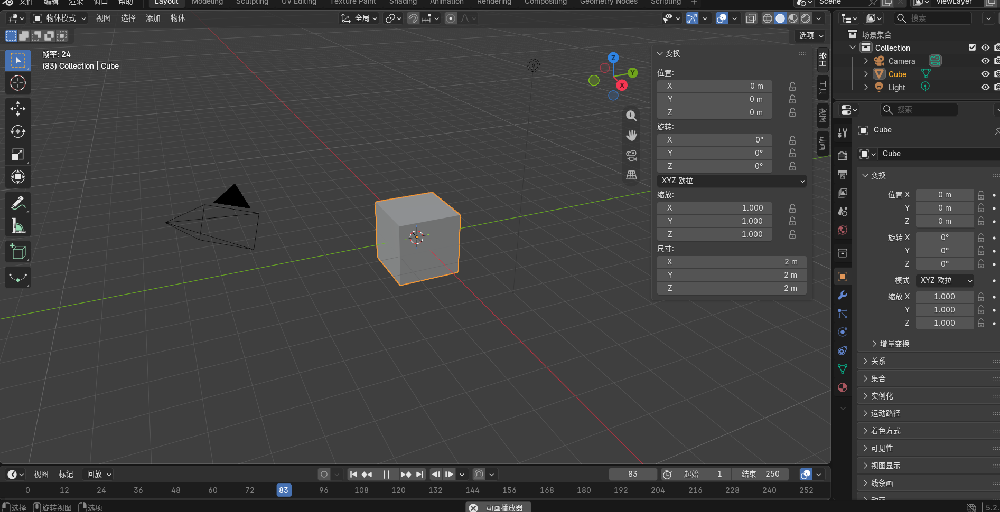

# BLENDER-NOTES — learning Blender's window

Blender version: 5.2 (as shown at the right end of the status bar; the course chapter used 5.1.2) · OS: Windows 11 · Interface language: Simplified Chinese

This was a short session with no prompting: I opened Blender with the default scene (cube, light, camera), orbited, panned and zoomed the viewport, opened the sidebar, and switched between Object Mode and Edit Mode on the default cube. My Blender runs in Chinese, so the Chinese labels I see are given in brackets.

*Screenshot taken by me in my own Blender session: Object Mode, the default cube selected (orange outline), sidebar open on the Item tab, Outliner and Properties editor on the right.*

## The six parts

**1. 3D viewport.** The big central area where the scene is shown and where I work on objects. The red line on the grid is the X axis and the green line is the Y axis; they cross at the world origin, which is where the default cube sits. Z points up. I orbit by dragging with the middle mouse button, pan with Shift + middle mouse, and zoom with the scroll wheel. The small red-and-white circle in the middle of the cube is the 3D cursor, which marks where new objects will be added. It is not the object's origin; the origin is the small orange dot.

**2. Toolbar.** The column of icons on the left side of the viewport (toggle with T). It holds the active tool: select, move, rotate, scale and others. The tools change with the mode, so Edit Mode shows extra mesh tools that Object Mode does not.

**3. Outliner.** The panel at the top right that lists everything in the scene as a tree: Scene Collection (场景集合) > Collection > Camera, Cube, Light. Clicking a name selects that object, and the eye icon hides it in the viewport. For this assignment it is the quickest way to see how many objects an asset is made of, which matters for the six-shape limit.

**4. Properties editor.** The panel under the Outliner with a column of tabs (render, output, scene, object, modifiers, material and more). It shows settings for the active object. The material tab is where an asset's flat colour (Base Colour) is set, and the object tab shows its transforms again.

**5. Sidebar (N).** Pressing N in the viewport opens a panel on its right edge. The Item tab shows the active object's Location (位置), Rotation (旋转), Scale (缩放) and Dimensions (尺寸), under Transform (变换). For the default cube, Dimensions are 2 m × 2 m × 2 m and Scale is 1, 1, 1. Dimensions are the real size in metres, which I will compare with my brief, and Scale must go back to 1, 1, 1 after I apply transforms. The MCP for Blender tab will also appear here once the add-on is enabled.

**6. Mode selector.** The drop-down at the left of the viewport header that reads "Object Mode" (物体模式); Tab switches quickly. In Object Mode I move, rotate and scale whole objects. In Edit Mode I work on the mesh itself: the cube's corners appear as vertices (the black dots in my first screenshot) and can be selected and moved one by one. Moving vertices in Edit Mode changes the shape without changing the object's scale.

## What I noticed

- My first screenshot was taken in Edit Mode by mistake: the cube showed black vertex dots and had no orange outline, so nothing was selected as an object. I pressed Tab to go back to Object Mode and clicked the cube to select it before taking the screenshot above.
- The same transform values appear in two places: the sidebar (N) and the object tab of the Properties editor. Both show location 0 m, rotation 0°, scale 1.000 and, in the sidebar only, dimensions 2 m × 2 m × 2 m.
- The timeline at the bottom was playing (frame 83 in the screenshot). It does not matter for static assets, but I will stop playback while building.

## Authorship note

Claude drafted the wording of these descriptions from my screenshot and the Blender manual's interface pages. I checked each part in my own Blender window and supplied both screenshots; the "What I noticed" points come from what happened in my session and what my screenshots show.
